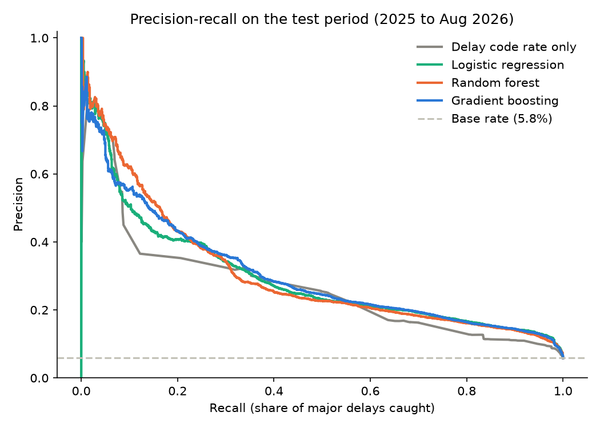
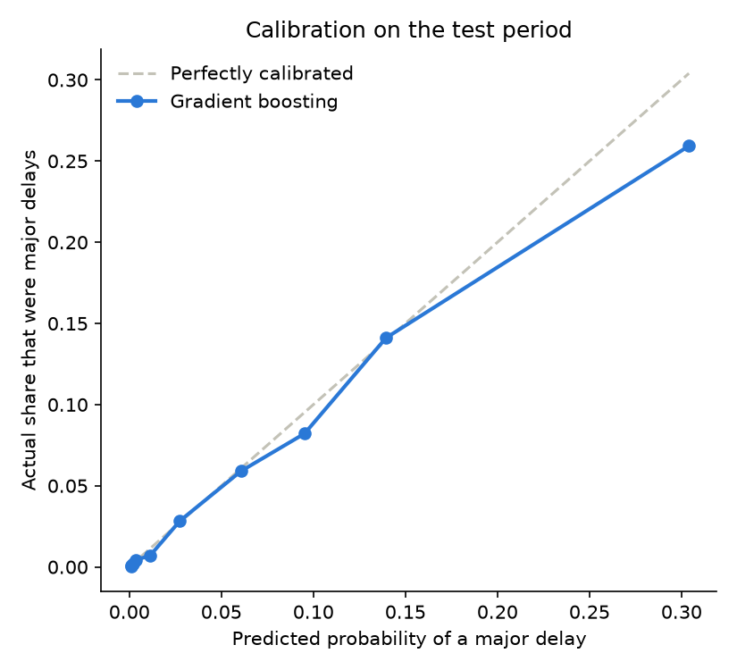
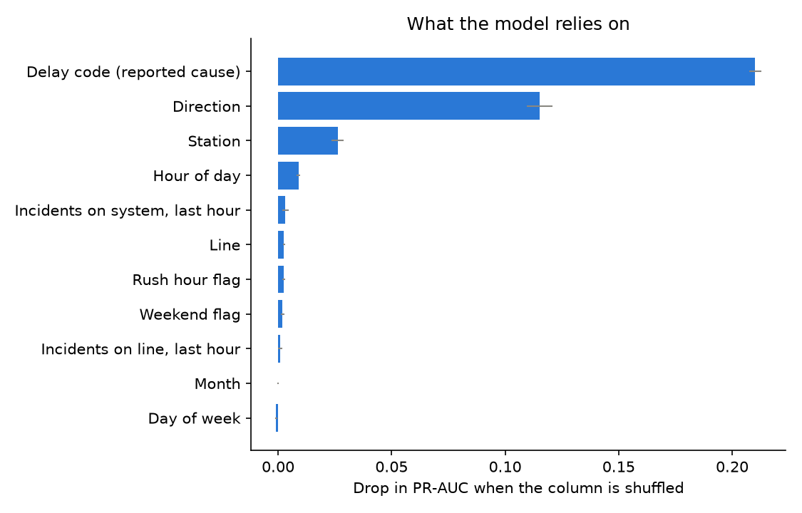
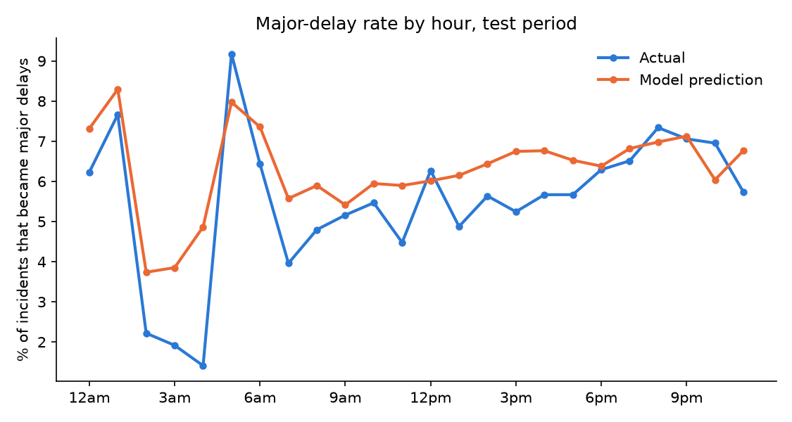
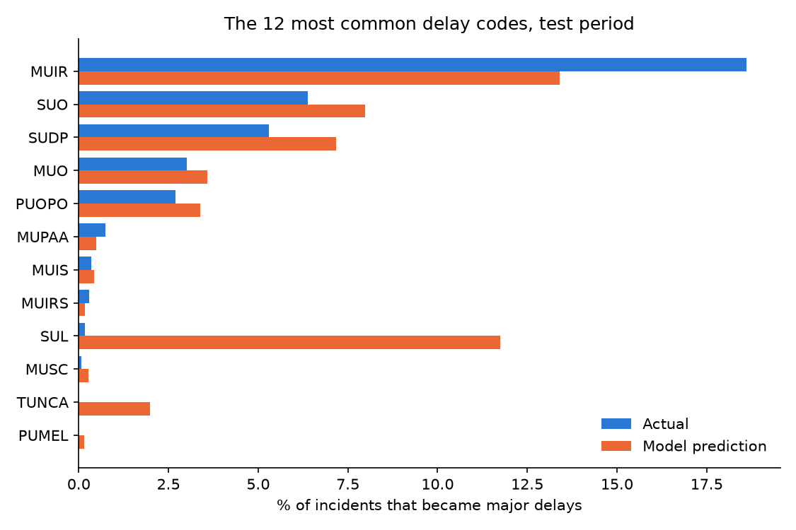

# Predicting Major TTC Subway Delays

A machine learning model that predicts, at the moment an incident is logged, whether it will turn into a **major delay (10+ minutes)**. Built on the same City of Toronto open data as [ttc-subway-delays](https://github.com/nrozario08/ttc-subway-delays), with feature building in SQL and models compared in Python (scikit-learn).

## Why this project

The first project in this series looked backwards: when and where TTC delays happen and what causes them. That left a more practical question. When a delay is announced, riders only know that something is wrong, not whether it is a two-minute hold or a twenty-minute problem. That difference decides whether you wait it out or reroute.

This project asks whether the information available when an incident is first logged (its reported cause, line, direction, station and time) is enough to tell the two apart, and how much better a model can do than simply looking up how serious that type of incident usually is.

## Problem

- **Unit:** one logged subway incident (164,933 from 2019 to August 2026).
- **Target:** `major_delay = 1` if the incident caused 10 or more minutes of delay. This is 6.4% of incidents, so the classes are heavily imbalanced.
- **Features** (known when the incident is logged): delay code, station, line, direction, hour, weekday, month, weekend and rush-hour flags, and the number of other incidents in the previous hour on the same line and on the whole system.
- **Left out on purpose:** the gap between trains (only known afterwards, it would leak the answer), the vehicle number, and the year.

## Validation

The split is by time, so the test set is genuinely "the future" from the model's point of view:

| Split | Period | Incidents | Major delay rate |
|---|---|---|---|
| Train | 2019 to 2023 | 93,074 | 6.6% |
| Validation | 2024 | 26,450 | 6.7% |
| Test | 2025 to Aug 2026 | 45,409 | 5.8% |

Settings (gradient boosting grid) and the alert threshold were chosen on the validation year only. Because of the class imbalance, the main metric is PR-AUC (average precision); ROC-AUC and the share of major delays captured in the riskiest 10% of incidents are also reported.

## Results (test period)

| Model | ROC-AUC | PR-AUC | Major delays caught in riskiest 10% |
|---|---|---|---|
| Always predict the base rate | 0.500 | 0.058 | 14% |
| **Baseline:** historical rate for the delay code only | 0.827 | 0.261 | 45% |
| Logistic regression | 0.861 | 0.296 | 43% |
| Random forest | 0.855 | 0.303 | 42% |
| **Gradient boosting** | **0.862** | **0.304** | 45% |



How to read this:

- The reported delay code does most of the work. Looking up how serious each code usually is already reaches ROC-AUC 0.83.
- The models improve the overall ranking over that baseline (PR-AUC 0.30 vs 0.26, ROC-AUC 0.86 vs 0.83) by combining the code with station, direction and time of day, but the gain is moderate, not dramatic. At the very top of the ranking (the riskiest 10%) the simple code lookup does as well as the models.
- **Alert rule:** flagging incidents with a predicted risk of at least 0.21 (threshold set on the validation year) flags 6.5% of incidents. On the test period, 32% of flagged incidents were major delays (against a 5.8% base rate, about 5.4 times higher) and the flags caught 35% of all major delays.
- Predicted probabilities track the actual rates closely, with slight overconfidence for the riskiest incidents (about 30% predicted against 26% actual in the top bin):



### A harder subset

Incidents with no direction recorded almost never become delays (0.2% are major, against 9.3% when a direction is logged). They are mostly events that never held up a train, so they are easy to rank. On the 29,543 test incidents where a direction was recorded (8.9% major), the model still reaches ROC-AUC 0.79 and PR-AUC 0.31, about 3.4 times the base rate, and the riskiest 10% contain 36% of the major delays.

## What drives the predictions

Permutation importance on the test period (how much PR-AUC drops when a column is shuffled):



1. **Delay code** is by far the most important input (for example, incidents where an injured or ill customer on a train refused medical aid have the highest major-delay rate among common codes).
2. **Direction** is second, largely because a missing direction signals that no train was affected.
3. **Station** and **hour of day** add smaller but real signal. The rest (weekday, month, line) contribute almost nothing once these are known.



## Experiments that did not help

- **"How busy was the last hour?" features.** Using SQL window functions (`COUNT(*) OVER (... RANGE BETWEEN 3600 PRECEDING AND 1 PRECEDING)`), I counted earlier incidents on the same line and system-wide. An ablation shows no gain (test PR-AUC 0.304 with them, 0.307 without). They remain in the modeling table and the model for transparency.
- **Delay-code family feature.** Adding the first two letters of the code as a fallback for unseen codes changed validation PR-AUC by only +0.005 but dropped test PR-AUC from 0.304 to 0.237, because new codes inherited the high risk of their family. I reverted it. That decision was informed by the test result, so the test figures above are slightly optimistic.

## Limitations

- **New delay codes.** Codes that first appear after the training period (for example `SUL`, which only shows up in 2026 with 1,131 incidents) are treated like rare codes and are over-predicted. Retraining periodically on recent data would reduce this.
- The model works from the incident report. It does not forecast delays before they happen, and it has no weather, ridership or schedule data.
- The 10-minute cut-off is a choice; other thresholds would give different results.
- Delay minutes are as logged by the TTC and may be recorded with some noise.



## Repository layout

```
sql/
  01_clean.sql             cleaning: lines, stations, duplicates, delay codes
  02_modeling_table.sql    features, recent-activity window functions, target
src/
  download_data.py         fetch the raw files from the open data portal
  build_db.py              load into SQLite and run the SQL files
  common.py                data loading, time-based split, metrics
  train.py                 baselines, models, tuning, alert threshold, figures
  explain.py               permutation importance and error analysis
reports/
  metrics.json, explain.json, figures/
```

## Running it

```bash
pip install -r requirements.txt
python src/download_data.py     # about 9 MB into data/raw/
python src/build_db.py          # builds data/ttc.db and the modeling table
python src/train.py             # trains and compares the models
python src/explain.py           # feature importance and error analysis
```

## Source and licence

Contains information licensed under the [Open Government Licence – Toronto](https://open.toronto.ca/open-data-license/). Data: [TTC Subway Delay Data](https://open.toronto.ca/dataset/ttc-subway-delay-data/).
